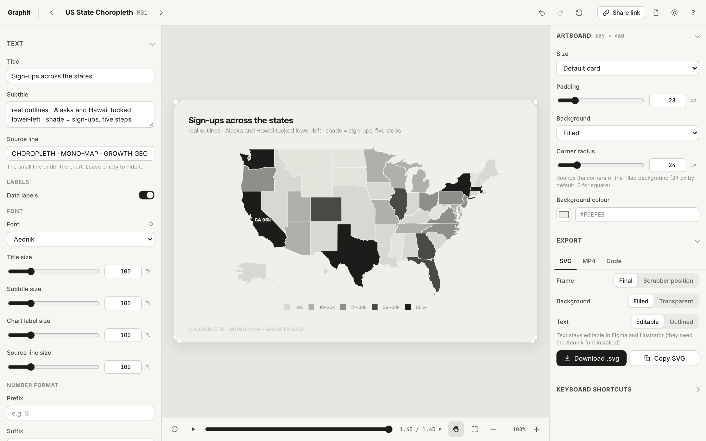

# Graphit

Graphit is a website for designing charts. Pick one of 65 chart designs, change its data, text, fonts, colours, layout, interactivity and animation, then export it as **SVG**, **MP4/WebM video** or **code** you can paste straight into a website or app.

Everything runs in your browser. Your data and charts are never uploaded to a server.


## Screenshots

**The editor.** Data and text on the left, a live preview in the middle, and size, colour and export settings on the right. Every number in a chart has a slider and a number box. Here the chart is set in Aeonik.



**Code export, in dark mode.** Copy a chart as an HTML snippet, a complete page, a React component, a JavaScript module or an embed.


**The gallery.** Filter by family or chart type, search by name, and preview every chart in four palettes: Mono, Porcelain, Palm and Wire.


## What's inside

65 charts in six families:

| Family | Charts |
|---|---|
| Basics (B01–B17) | Rung Bars, Hairline Line, Hairline Area, Tick Donut, Tick Rows, Paired Rungs, Stacked Rungs, Plumb Scatter, Rung Waterfall, Dot Heat, Tick Gauge, Dumbbell Queue, Nested Treemap, Rung Histogram, Tick Box, Stream Ribbon, Candlestick |
| Glance (G01–G20) | Chunky Bars, Donut Redesigned, Pictorial Bar, Circular Graph, Tree, Dual Area, Scatter Morph, Diverging Bar, Force Graph, Stagger Delay, Custom Pie, Single Axis, Jitter Strip, Bar Race, Dynamic Data, Draw-in + Counter, Violin, Matrix Heat, Rank Strip, Aggregate Sankey |
| Editorial (L01–L19) | Launch Fan, Dot Cascade, Barcode Lollipop, Arc Matrix, Radial Convergence, Cluster Field, Brand Spectrum, Dotty Matrix, Bubble Almanac, Radial Patchwork, Trend Lineage, Type Colonnade, Hourglass Stream, Hundred Field, Ballot Tally, Matrix Heat, Calendar Heat, Ridgeline, Parallel Coordinates |
| Maps (M01–M02) | US State Choropleth, World Choropleth (shaded, or switched to bubbles) |
| Networks (N01–N03) | Force Graph (dense), Circular Graph (dense), Thread Triptych |
| Extras (X01–X04) | Tick Strip, Category Lollipop, Hundred Faces, Ballot Rings |

Every chart can be set in one of nine fonts. Pick one under **Text → Font** in the editor:

| Kind | Fonts |
|---|---|
| Sans serif | **Inter** (the default), Aeonik, Roboto, Fira Sans, Montserrat |
| Serif | IBM Plex Serif, PT Serif |
| Monospaced | JetBrains Mono, Cascadia Mono |

## How it works

- **One rule for every chart.** A chart is drawn by a pure function of data, settings, palette and animation time. The live preview, SVG export, every video frame and the code exports all call that same function, so they always match.
- **Charts are hand-written SVG.** No charting library is used. Each chart is built with the same small helpers (`el`, `txt`, `tip`), and every number in it is a setting.
- **The editor is generated.** Each chart lists its settings (ranges, options, defaults), and the editor builds the sliders, number boxes, colour pickers and switches from that list.

More detail is in [docs/ARCHITECTURE.md](docs/ARCHITECTURE.md).

### Project layout

```
src/
  core/         chart engine: shapes, animation, palettes, card layout, text measuring, SVG output
  charts/       one file per chart (e.g. charts/basics/B01.ts), shared layout helpers,
                registry.ts (every chart) and catalog.ts (the gallery's order and titles)
  runtime/      playback and interactions, shared by the preview, embeds and exported code
  export/       SVG, video and code exports
  pages/, ui/   the React app: gallery, editor and embed page
  state/        saved edits, undo/redo, share links
  styles/       app styles and font loading
public/fonts/   Inter and Aeonik font files (the other fonts come from @fontsource packages)
scripts/        build helpers: per-chart export bundles, letter widths, map outlines
tests/          unit tests (Vitest) and browser tests (Playwright)
docs/           architecture notes and the screenshots above
```

## Fonts and map data

- **Inter, Roboto, Fira Sans, Montserrat, IBM Plex Serif, PT Serif, JetBrains Mono and Cascadia Mono** are free, open-source fonts.
- **Aeonik** is a commercial font. Its files are in `public/fonts/aeonik/`, so anyone who visits the published site can download them. Make sure your Aeonik licence covers use on a website. If it doesn't, remove Aeonik before publishing: delete that folder and its entries in `src/core/fonts.ts`, `src/export/fonts.ts` and `src/core/text/all-metrics.ts`.
- **Map outlines** come from [Natural Earth](https://www.naturalearthdata.com) (countries) and the [U.S. Census Bureau](https://www.census.gov) (states), both public domain.
