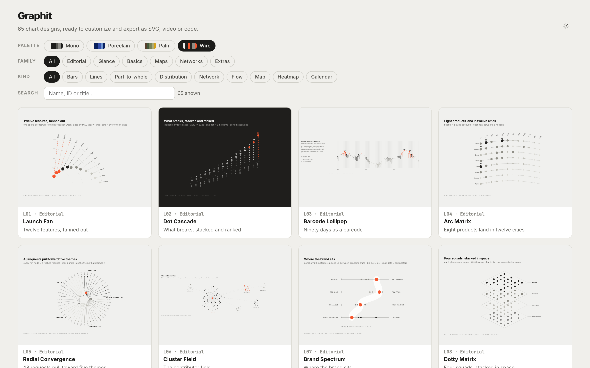
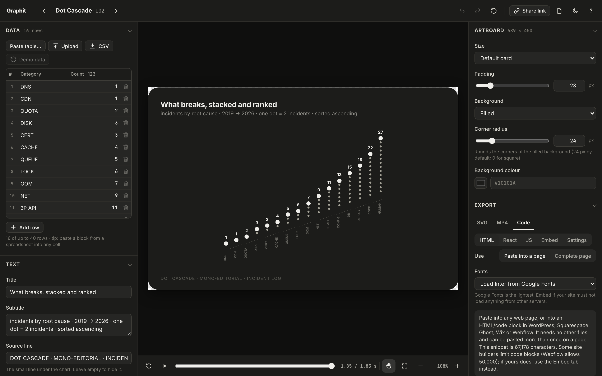
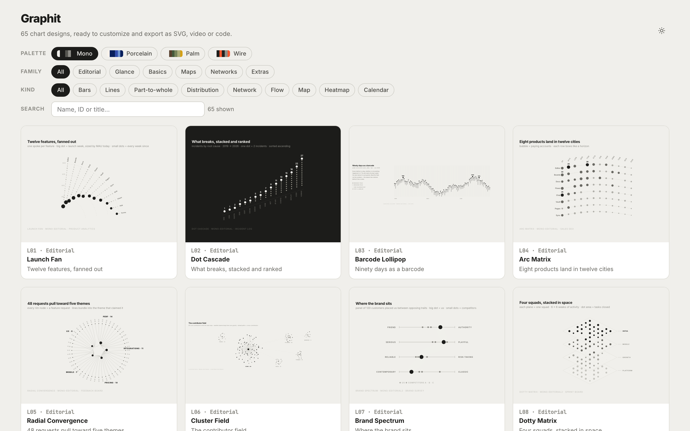

# Graphit

Graphit is a website for designing charts. Pick one of 65 chart designs, change its data, text, fonts, colours, layout, interactivity and animation, then export it as **SVG**, **MP4/WebM video** or **code** you can paste straight into a website or app.

Everything runs in your browser. Nothing is uploaded to a server.



## Screenshots

**The editor.** Data and text on the left, a live preview in the middle, and size, colour and export settings on the right. Every number in a chart has a slider and a number box. Here the chart is set in Aeonik.


**Code export, in dark mode.** Copy a chart as an HTML snippet, a complete page, a React component, a JavaScript module or an embed.



**The gallery.** Filter by family or chart type, search by name, and preview every chart in four palettes: Mono, Porcelain, Palm and Wire.



## What's inside

65 charts in six families:

| Family | Charts |
|---|---|
| Basics (B01–B17) | Rung Bars, Hairline Line, Hairline Area, Tick Donut, Tick Rows, Paired Rungs, Stacked Rungs, Plumb Scatter, Rung Waterfall, Dot Heat, Tick Gauge, Dumbbell Queue, Nested Treemap, Rung Histogram, Tick Box, Stream Ribbon, Candlestick |
| Glance (G01–G20) | Chunky Bars, Donut Redesigned, Pictorial Bar, Circular Graph, Tree, Dual Area, Scatter Morph, Diverging Bar, Force Graph, Stagger Delay, Custom Pie, Single Axis, Jitter Strip, Bar Race, Dynamic Data, Draw-in + Counter, Violin, Matrix Heat, Rank Strip, Aggregate Sankey |
| Editorial (L01–L19) | Launch Fan, Dot Cascade, Barcode Lollipop, Arc Matrix, Radial Convergence, Cluster Field, Brand Spectrum, Dotty Matrix, Bubble Almanac, Radial Patchwork, Trend Lineage, Type Colonnade, Hourglass Stream, Hundred Field, Ballot Tally, Matrix Heat, Calendar Heat, Ridgeline, Parallel Coordinates |
| Maps (M01–M02) | US State Choropleth, World Choropleth (shaded, or switched to bubbles) |
| Networks (N01–N03) | Force Graph (dense), Circular Graph (dense), Thread Triptych |
| Extras (X01–X04) | Tick Strip, Category Lollipop, Hundred Faces, Ballot Rings |

Every chart can be set in one of nine fonts. Pick one under **Text → Font** in the editor:

| Kind | Fonts |
|---|---|
| Sans serif | **Inter** (the default), Aeonik, Roboto, Fira Sans, Montserrat |
| Serif | IBM Plex Serif, PT Serif |
| Monospaced | JetBrains Mono, Cascadia Mono |

## Run it on your computer

You need [Node.js](https://nodejs.org) version 24.

1. Open the Terminal app.
2. Type `cd ` (with a space after it), drag the project folder from Finder into the Terminal window, then press Enter.
3. Install the dependencies. You only need to do this once, and again whenever `package.json` changes:
   ```sh
   npm install
   ```
4. Start the app:
   ```sh
   npm run dev
   ```
5. Open http://localhost:5173 in your browser. To stop the app, click the Terminal window and press `Ctrl+C`.

## Other commands

| Command | What it does |
|---|---|
| `npm run build` | Checks the code for errors, then builds the website into `dist/` (this is what Vercel runs) |
| `npm run preview` | Serves the built `dist/` folder on your computer |
| `npm test` | Runs the fast unit tests (Vitest) |
| `npm run test:e2e` | Runs the browser tests (Playwright). The first time, run `npx playwright install chromium` |
| `npm run gen:metrics` | Rebuilds the fonts' letter-width tables (used to wrap titles and place labels) after a font changes |
| `npm run geo` | Downloads the map data and rebuilds the maps' outline files |

## Put it online

The site is a static Vite app, so it can be hosted on Vercel for free.

**1. Upload the folder to GitHub.** [GitHub Desktop](https://desktop.github.com) is the easiest way:

1. Install GitHub Desktop and sign in with your GitHub account.
2. Choose **File → Add Local Repository…** and pick the project folder.
3. If it lists changes, type a short summary in the box at the bottom left and click **Commit to main**.
4. Click **Publish repository**. Keep **Keep this code private** ticked unless you want it public, then click **Publish Repository**.

Only the files the project needs are uploaded. `.gitignore` leaves out `node_modules/`, the `dist/` build folder, downloaded map data and test output, because Vercel rebuilds those itself.

**2. Deploy it on Vercel:**

1. Go to [vercel.com](https://vercel.com) and sign up or log in with your GitHub account.
2. Click **Add New… → Project**, find the repository in the list and click **Import**.
3. Keep the settings Vercel detects: framework **Vite**, build command `npm run build`, output folder `dist`. Vercel uses Node.js 24, as `package.json` asks.
4. Click **Deploy**. After about a minute you get a web address for the site.

Every time you commit and push a change from GitHub Desktop, Vercel rebuilds the site automatically. `vercel.json` sends every page address to the app, so links like `/chart/b01` work.

## Use an exported chart

Open a chart, then the **Code** tab on the right. Each format is ready to paste as it is:

| Format | Where it goes |
|---|---|
| HTML snippet | Any web page, or an HTML/code block in WordPress, Squarespace, Ghost, Wix or Webflow. Paste it more than once if you like. |
| Complete HTML page | Its own `.html` file. Opens by double-click. |
| React component | Save the file in your app and render it, e.g. `<RungBarsChart />`. Works in Next.js and Vite. |
| JavaScript module | Vue, Svelte, Angular or plain JavaScript: `mountChart(element)`, or the `<graphit-b01>` tag. |
| Embed | An `<iframe>`, for Notion, Framer or a page that limits code size. |

The chart draws inside its own sealed box (a shadow root), so your site's styles can't break it. Fonts load from Google Fonts, are embedded in the file, or come from your own site. Aeonik isn't on Google Fonts, so a chart set in Aeonik always embeds it.

## How it works

- **One rule for every chart.** A chart is drawn by a pure function of data, settings, palette and animation time. The live preview, SVG export, every video frame and the code exports all call that same function, so they always match.
- **Charts are hand-written SVG.** No charting library is used. Each chart is built with the same small helpers (`el`, `txt`, `tip`), and every number in it is a setting.
- **The editor is generated.** Each chart lists its settings (ranges, options, defaults), and the editor builds the sliders, number boxes, colour pickers and switches from that list.

More detail is in [docs/ARCHITECTURE.md](docs/ARCHITECTURE.md).

### Project layout

```
src/
  core/         chart engine: shapes, animation, palettes, card layout, text measuring, SVG output
  charts/       one file per chart (e.g. charts/basics/B01.ts), shared layout helpers,
                registry.ts (every chart) and catalog.ts (the gallery's order and titles)
  runtime/      playback and interactions, shared by the preview, embeds and exported code
  export/       SVG, video and code exports
  pages/, ui/   the React app: gallery, editor and embed page
  state/        saved edits, undo/redo, share links
  styles/       app styles and font loading
public/fonts/   Inter and Aeonik font files (the other fonts come from @fontsource packages)
scripts/        build helpers: per-chart export bundles, letter widths, map outlines
tests/          unit tests (Vitest) and browser tests (Playwright)
docs/           architecture notes and the screenshots above
```

## Add a new chart

1. Create `src/charts/<family>/<ID>.ts` and export `defineChart({...})`. Copy the structure of `src/charts/basics/B01.ts`:
   - the data columns and the demo data;
   - the chart's own settings, each with a label, range and default;
   - a `draw(ctx)` function that draws the chart.
2. Add it to `src/charts/registry.ts`, and give it a gallery entry in `src/charts/catalog.ts`.
3. Run `npm test` and `npm run test:e2e`. The tests in `tests/unit/charts.test.ts` and `tests/e2e/charts.spec.ts` check every registered chart automatically.

## Fonts and map data

- **Inter, Roboto, Fira Sans, Montserrat, IBM Plex Serif, PT Serif, JetBrains Mono and Cascadia Mono** are free, open-source fonts.
- **Aeonik** is a commercial font. Its files are in `public/fonts/aeonik/`, so anyone who visits the published site can download them. Make sure your Aeonik licence covers use on a website. If it doesn't, remove Aeonik before publishing: delete that folder and its entries in `src/core/fonts.ts`, `src/export/fonts.ts` and `src/core/text/all-metrics.ts`.
- **Map outlines** come from [Natural Earth](https://www.naturalearthdata.com) (countries) and the [U.S. Census Bureau](https://www.census.gov) (states), both public domain.
